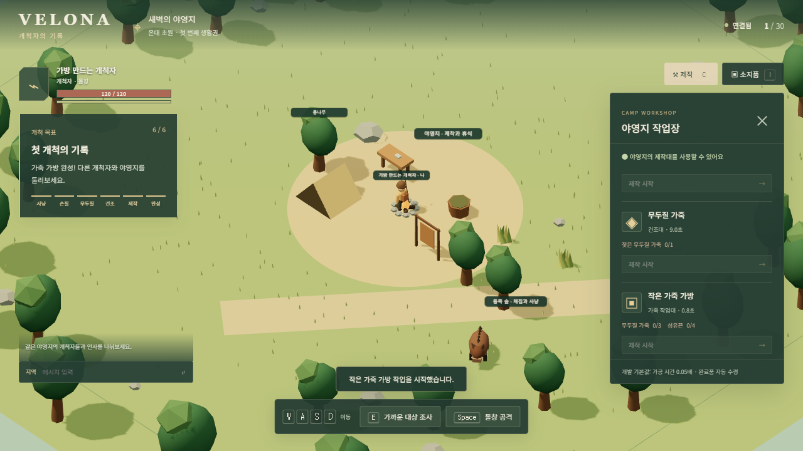

# Velona

함께 야영지를 탐험하고, 사냥한 가죽을 가공해 생활 도구를 만드는 웹 생활·생존 게임입니다. 기존 Velora·Wildscape Frontier 기획을 기반으로 개발하며, 저장소와 프로젝트 이름은 **Velona**로 통일합니다.

현재는 첫 온라인 시제품입니다. 채널 30명은 입장 제한과 향후 검증 목표이며, 30인 서비스 성능을 확인한 상태는 아닙니다. 게스트 정보·인벤토리·생산 작업·해체 권리는 **PostgreSQL에 저장하고 서버 재시작 시 복구**합니다. 초기 저장은 1초 주기의 원자적 월드 체크포인트이며 비정상 종료 직전 약 1초는 유실될 수 있습니다. 정식 회원 계정·거래 장부·운영 배포는 후속 단계입니다.



## 저장소 구조

| 경로 | 내용 |
| --- | --- |
| `frontend/` | React·TypeScript·Three.js 웹 클라이언트 |
| `backend/` | C#·.NET 10·ASP.NET Core SignalR 서버와 테스트 |
| `docs/design/` | 전체 기획, 몬스터·재료·제작·장비 JSON |
| `docs/development/` | 초기 구현 범위, 통신 규칙, 개발·검증 기록 |
| `scripts/` | 기획 데이터 검사 |
| `.github/workflows/` | 프론트·백엔드·데이터·브라우저 자동 검사 |

## 개발 환경

- Node.js 24 계열과 npm
- .NET 10 SDK (`global.json`에서 10.0 계열 사용)
- PostgreSQL 18 계열(현재 로컬 주소 127.0.0.1:7738, DB velona_dev)
- PC의 WebGL2 지원 브라우저
- C# 서버는 Visual Studio 2026, 웹 화면은 VS Code 사용을 권장합니다.

## 실행

로컬 DB와 접속 설정은 이번 작업에서 생성했습니다. 다른 PC에서 처음 준비할 때는 `powershell -File scripts/setup-local-db.ps1`로 관리자·프로젝트 계정 비밀번호를 입력합니다. 인증 정보는 .NET 로컬 설정에만 저장합니다. 자세한 내용은 [로컬 접속 안내](docs/development/04-local-postgresql.md)를 참고하세요.

저장소 루트에서 백엔드를 실행합니다.

```powershell
dotnet restore backend/Velona.slnx
dotnet run --project backend/Velona.Server
```

별도의 터미널에서 웹 화면을 실행합니다.

```powershell
cd frontend
npm ci
npm run dev
```

브라우저에서 `http://127.0.0.1:5173`에 접속합니다. 백엔드 개발 주소는 `http://127.0.0.1:5080`이며 Vite가 API·SignalR 요청을 전달합니다. 서로 다른 브라우저나 별도 브라우저 컨텍스트로 접속하면 두 플레이어를 확인할 수 있습니다.

## 첫 플레이

야영지에서 대상으로 이동해 E로 조사하고 재료 목록에서 원하는 항목을 선택합니다. 재료별 시간 작업이 끝나야 획득하며, 멧수 사체의 가죽·고기·뼈도 따로 해체합니다. 숙련도가 오르면 작업 시간이 줄어듭니다. 전처리→무두질→건조를 거쳐 가죽을 준비하고 섬유끈과 함께 가방을 만듭니다. 초기 설비와 돌창·돌칼은 튜토리얼용으로 제공됩니다.

기초 제작법 6개만 실제 구현합니다. 기획 데이터 전체가 실행되는 것은 아닙니다. 테스트를 위해 생산 시간은 기본 0.05배이며 무두질 240초는 12초로 진행됩니다. UI와 개발 문서에 이 차이를 표시합니다. 물은 야영지 공급으로 처리하고 완성 작업은 한 번만 자동 수령합니다.

## 검사

```powershell
node scripts/validate-design.mjs
dotnet test backend/Velona.slnx --configuration Release
```

프론트엔드 폴더에서 실행합니다.

```powershell
npm run test:unit
npm run build
npx playwright install chromium
npm run test:e2e
```

브라우저 검사는 서버와 웹 화면을 자동으로 시작합니다. 결과 화면과 실패 정보는 `frontend/test-results/`, `frontend/playwright-report/` 등에 남으며 저장소에는 올리지 않습니다. 기획 자료의 오래된 검사 보고서는 현재 CI 결과를 대신하지 않습니다.

## GitHub Actions

`main`에 올리거나 `main` 대상 PR을 만들면 데이터 검사, 프론트 빌드·단위 검사, 백엔드 검사·배포물 생성 후 브라우저 통합 검사를 실행합니다. Actions 화면에서 수동 실행도 가능합니다. 빌드 산출물은 7일간 보관하며 자동 운영 배포는 하지 않습니다. 공식 Action 버전은 고정 식별자를 사용하고 Dependabot으로 갱신을 제안받습니다.

## 기획과 다음 단계

- [전체 기획 목차](docs/design/README.md)
- [시간 채집과 숙련도](docs/development/05-timed-gathering.md)
- [초기 플레이와 통신 규칙](docs/development/01-initial-slice-contract.md)
- [개발 환경·명령·제한](docs/development/02-development-guide.md)
- [초기 검증 기록](docs/development/03-verification.md)

후속 작업은 정식 계정과 아이템별 거래 장부, 개인 거점·건축·작업 수령, 지역 확장·환경 장비, 채널 30인 부하 검증 순서로 진행합니다. 현재 아트는 직접 만든 시제품 표현이며 최종 모델·음향 자산이 아닙니다.
