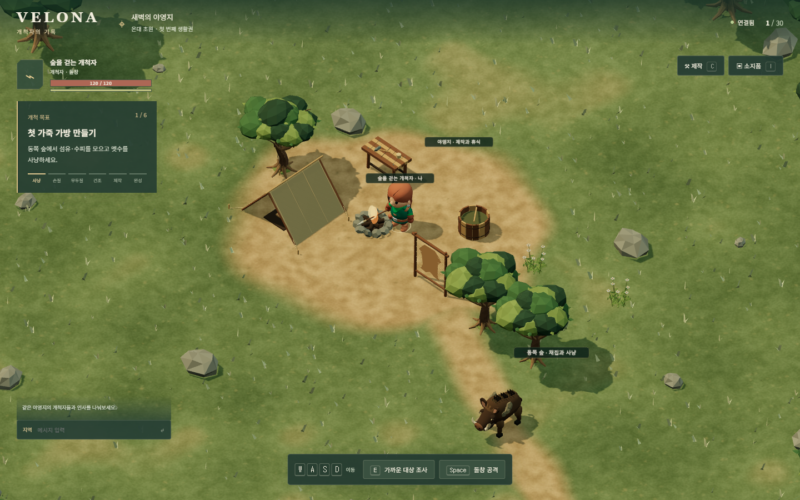

# 첫 숲 아트 패스

2026-11-15 기준. 캐릭터·돌턱멧수·나무·식물·바위·야영지를 실제 플레이 화면에서 구분할 수 있도록 바꾼 첫 시각 개선이다. 전체 게임의 최종 아트나 운영용 30인 성능 인증은 아니다. 서버의 이동·충돌·공격·채집·보상 규칙은 변경하지 않았다.



## 아트 방향과 적용

흙빛 가죽·린넨, 녹색 숲, 따뜻한 햇빛과 차분한 그림자를 사용한다. 나무의 뿌리와 가지, 동물의 다리와 엄니가 게임 카메라에서도 읽히게 구성했다. 전경의 큰 나무가 적을 가리던 문제를 확인하고 배치·높이를 조정했다.

| 대상 | 현재 구현 |
| --- | --- |
| 개척자 | 실제 스켈레톤 모델, 대기·달리기·작업·창 찌르기·쓰러짐, 가방·침낭·돌창·플레이어 색 스카프 |
| 돌턱멧수 | 가늘어지는 몸통·주둥이, 눈·콧구멍·귀, 휘어진 엄니, 갈기, 갈라진 굽, 돌턱·어깨 돌판, 보행·호흡·공격 예고 자세 |
| 나무 | 뿌리·갈라진 줄기·가지·이끼, 비대칭 수관, 3개 실루엣 변형, 가까이서 플레이어를 가리는 수관은 반투명 |
| 채집 식물·바위 | 섬유 줄기·꽃·고사리, 갈라진 암석·광맥·지의류 |
| 야영지 | 판재 작업대·도끼·실타래, 열린 무두질 통과 테, 끈으로 묶은 가죽, 천막 솔기·지지대·말뚝·침낭, 화덕 |
| 지면 | 클라이언트마다 같은 씨앗으로 만든 숲 바닥·흙길 텍스처와 짧은 풀 인스턴스 |

카메라는 기존보다 가까워져 캐릭터를 읽기 쉽다. 모바일 목표 패널은 제목과 단계만 남겨 몬스터 상태와 겹치지 않는다. 이름표끼리 조금 겹칠 수 있어 후속 정리가 필요하다.

## 외부 자산과 권리

캐릭터는 [KayKit Character Pack Adventures](https://github.com/KayKit-Game-Assets/KayKit-Character-Pack-Adventures-1.0)의 Rogue이며 CC0-1.0이다. 원본 커밋·다운로드 주소·원본 및 가공본 SHA256·변경 사항은 `frontend/public/assets/characters/provenance.json`, 이용 조건은 같은 폴더의 `LICENSE-KayKit.txt`에 보존했다. 브라우저는 저장소에 포함된 GLB만 요청하며 외부 모델 서버에 의존하지 않는다.

원본 3.6MB에서 불필요한 무기·망토·동작을 제거해 런타임 GLB를 **556,944바이트**로 줄였다. 캐릭터당 본 41개, 보존 동작 8개, 몸체와 장비 4개 메시·총 4,655삼각형, 공유 아틀라스 텍스처 1개다. 모델은 지연 로딩하고 복제된 본·색상 재료를 개별 정리하며 원본 형상·아틀라스는 공유한다. 실패 시 임시 실루엣을 유지하고 개발 진단의 `characterErrors`에 표시한다. 브라우저 검사는 모델 로딩 완료를 별도로 확인한다.

실제 생성 도구 점검 결과는 다음과 같았다. 생성 API 호출이나 키 저장은 하지 않았다.

```text
TRIPO_API_KEY=MISSING
GEMINI_API_KEY=MISSING
```

자산 공급 기록: 개척자는 CC0 가져오기+자체 생활 장비의 혼합 방식, 멧수·수목·식물·바위·야영지는 자체 형상, 바닥은 자체 캔버스 텍스처다. 3D/이미지 생성은 위 점검 결과 때문에 사용하지 않았다. 음향·로고·아이템 아이콘 제작은 이번 대상에 포함하지 않았다.

## 렌더링 예산과 측정

기준 예산은 데스크톱 300호출/75만 삼각형, 모바일 150호출/30만 삼각형이다. 반복 수목·바위·풀은 인스턴스, 야영지와 생물의 작은 형상은 재료별 병합을 사용한다. 나무는 템플릿당 4메시/3,512삼각형, 멧수는 11메시/6,804삼각형이다. 그림자는 광원 1개, 데스크톱 최초 생성 2048·모바일 최초 생성 1024 지도, DPR 상한1.5, 후처리0패스다. 창 크기만 변경하면 최초 그림자 지도 크기를 유지한다.

| 확인 상태 | 호출 | 삼각형 | 형상 | 텍스처 | 색 엔트로피 | 경계 밀도 | 밝기 대비 |
| --- | ---: | ---: | ---: | ---: | ---: | ---: | ---: |
| PC 야영지 1440×900 | 74 | 225,967 | 50 | 9 | 4.41 | 0.101 | 99.1 |
| PC 재료 목록 | 77 | 225,973 | 50 | 12 | 4.91 | 0.114 | 111.9 |
| PC 채집 진행 | 77 | 225,973 | 50 | 12 | 4.92 | 0.117 | 111.2 |
| PC 공격 입력 | 77 | 225,973 | 50 | 12 | 4.54 | 0.107 | 100.2 |
| 모바일 390×844 | 69 | 219,493 | 50 | 12 | 5.36 | 0.151 | 110.7 |

진단은 플레이어1명, DPR1 화면에서 캡처했다. 최대 지배 색상 점유율은0.248이며 빈 단색 캔버스가 아니다. 모바일 행은 화면 크기 변경에 대한 확인이고 실제 휴대전화 GPU 속도·30명 밀집 프레임을 측정한 값은 아니다. 두 사용자 동시 접속·전체 제작은 별도 Playwright 경로로 확인한다. 소프트웨어 렌더러의 시간은 실제 GPU 프레임 성능으로 주장하지 않는다.

실제 형상은 표시만 담당하며 서버의 단순 원형 충돌을 유지한다. 나뭇잎과 작은 시각 장식에는 별도 충돌을 추가하지 않았다. 충돌 모양과 시각 장식을 혼동하지 않도록 큰 장식 수목은 플레이 구역 가장자리에 배치했다.

## 시각 검토와 한계

독립 검토에서 최초 화면의 전경 수관·검은 풀 조각·모바일 패널 겹침·화덕 내부에 선 캐릭터를 지적했고, 모두 수정한 뒤 5개 화면 전체를 다시 검토했다. 최종 검토에서는 첫 아트 패스를 막는 중요한 시각 문제가 남지 않았다. 정식 고품질 완성 판정은 하지 않는다.

| 공통 시각 평가 항목(0–3) | 기존 | 현재 | 근거 |
| --- | ---: | ---: | --- |
| 아트 방향 | 1 | 2 | 장비·야영지·숲의 흙빛 재료와 형태 통일 |
| 플레이어 | 1 | 2 | 본 애니메이션과 실제 의복·생활 장비 |
| 적 | 1 | 1 | 형태와 모션은 개선, 실제 적 종류는 아직 하나 |
| 상호작용 대상 | 1 | 2 | 나무·식물·바위의 서로 다른 형태와 채집 UI |
| 환경 | 1 | 2 | 지면·야영지·숲의 층과 이동로 유지 |
| 재료·텍스처 | 1 | 2 | 공유 아틀라스·지면 텍스처·형상별 색·거칠기 |
| 조명 | 1 | 2 | 햇빛·하늘광·보조광과 접지 그림자 |
| 효과·동작 | 1 | 1 | 걷기·작업·공격 연결, 채집 획득/피격 효과는 후속 |
| HUD | 2 | 2 | 모바일 겹침 수정, 플레이 영역 확보 |
| 성능 근거 | 1 | 2 | PC/모바일 캡처·픽셀·호출/삼각형·오류 확인 |
| 평균 | 1.1 | 1.8 | 전체 게임의 프리미엄 판정에는 미달 |

기존 화면은 이전 채집 화면과 비교했다. 초기 독립 점수는1.7/3, 수정 후 독립 검토는 전경 가림·패널 겹침 등 원래 지적의 해결을 확인했다. 적 다양성과 획득·피격 효과, 최종 UI 아트, 밀집 성능은 범위 밖으로 남는다. 현재 검토를 최종 서비스 품질 인증으로 해석하지 않는다.

## 검증과 작업 기록

프론트 단위7개·타입 검사·배포 빌드, 브라우저 모델 로딩, PC/모바일 캡처, 페이지·콘솔 오류0, 실제 키 입력·시간 채집을 확인했다. 브라우저5개 경로는 이동·두 사용자·사냥·해체·가죽 가방 제작·채집 중단·좁은 화면을 포함한다. 변경 중 화면 새로고침과 입력 종료 지연을 확인해 자동 걷기 검사가 키 해제 후 서버 위치가 안정된 것을 기다리도록 조정했다.

화면 기준선은 아직 고정하지 않는다. 진행 중인 공유 월드와 서버 시각을 정지시키기 위한 쓰기 테스트 훅을 추가하지 않고, 기존 읽기 전용 관찰·실제 입력·자산 로딩·픽셀 통계·검토 캡처를 확장했다. `npm run test:e2e`, `npm run test:unit`, `npm run build`로 검증한다.

진행 기록: 그래픽·3D 공급·이미지 공급·UI·QA 지침과 모델/렌더/기술 아트/시각 평가/셰이더/검증/반응형 참고를 읽고 적용했다. 그래픽·UI·QA 단계는 위 화면과 측정으로 확인했다. 신규 게임 설계·진행 체계·서버 규칙·음향 생성 단계는 기존 기능을 보존하는 이번 시각 작업 범위에서 제외했다. 자산 공급은 CC0 도입과 생성 도구 누락 근거를 기록했다.
