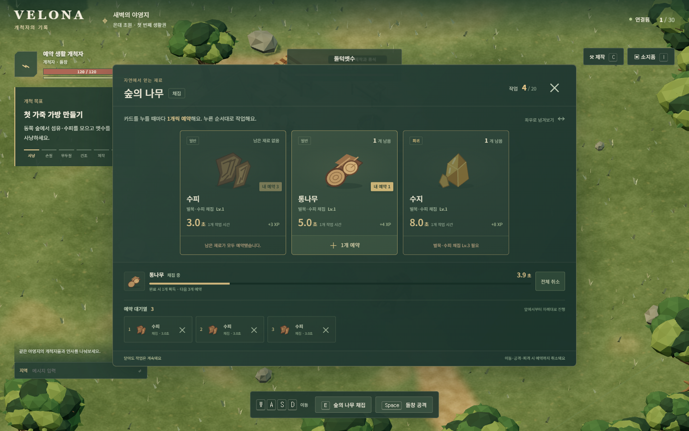
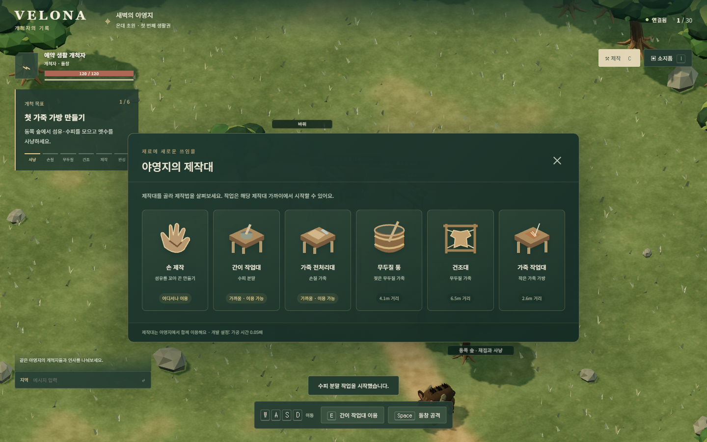

# 중앙 재료 카드와 예약 채집·제작대 이용

2026-11-15. 사용자가 선택한 규칙은 **카드 한 번 클릭당 재료1개 예약**이며, 후속 개발은 제작대별 실제 이용이다. 이전05 문서의 묶음 지급과 재료 칸 단독 예약을 아래 규칙으로 대체한다. 기존 소지품·숙련도·생산 작업은 보존한다.

## 플레이 흐름

재료와 수량을 스스로 고르고 작업 순서를 계획하는 생활 게임 경험을 만든다. 풀숲·나무·바위·사체 근처에서 E로 조사하면 화면 가운데 카드들이 가로로 펼쳐진다. 각 카드에는 재료 그림·잔량·내 예약 수·등급·숙련도·1개 작업 시간·경험치를 표시한다. 작은 화면에서는 카드를 좌우로 넘긴다.

카드를 누를 때마다 해당 재료1개를 FIFO 대기열에 넣고, 쉬고 있으면 첫 작업을 바로 시작한다. 세 번 누르면1개 작업 세 번이며 한 번에3개를 지급하지 않는다. 서로 다른 재료도 클릭한 순서대로 진행한다. 활성 작업을 포함한 한도는20개이며, **한 대상의 실제 남은 수량** 내에서만 예약할 수 있다. 작업 중 목록을 닫아도 진행하며 작은 하단 진행창에서 확인·취소할 수 있다.

대기 항목의 ×는 그 항목1개만 제거한다. 전체 취소는 현재 작업과 나머지 예약을 모두 취소한다. 이동·실제 공격·피격·쓰러짐·접속 종료·대상 소멸도 현재 작업과 남은 예약을 모두 취소한다. 이미 완료해 받은 재료와 경험치는 남고, 미완료 작업에는 보상이 없다.

핵심 반복은 **목록 확인→수량과 순서 선택→위협을 살피며 작업→완료 재료 확보→설비 가공**이다. 실패하면 예약을 돌려주므로 안전한 위치에서 다시 시도한다. 야영지는 학습과 가공, 동쪽 멧수 구역은 사냥 위험과 개인 해체 권리, 각 제작대는 재료를 생활용품으로 바꾸는 역할이다.

## 수량·시간·권한

`gathering.json`의 quantity는 이제 재료별 생성 수량이다. 풀섬유3·수피3·통나무2처럼 한 번의 잔량을 정하고, 각 작업은 그중1개를 소비한다. base_seconds와 experience는 재료1개 작업 기준이다. 숙련 시간 감소·희귀 재료 잠금·최대 레벨은 유지하며, 각 작업이 실제로 시작할 때 최신 숙련으로 시간을 계산한다. 직접 채집에는 생산 개발 배율0.05를 적용하지 않는다.

공유 자원은 전원 예약을 합해 실제 잔량을 넘지 않도록 한다. 예약 수량만 다르다면 여러 플레이어가 같은 재료를 작업할 수 있다. 완료할 때1개를 소모하며, 취소하면 미소비 예약을 즉시 풀어준다. 재료별 잔량이0이 되면8초 뒤 원래 수량으로 재생한다. 다른 재료의 잔량과 재생은 독립적이다. 자원의 시각적 활성 여부는 개인의 가방·대기열 상태가 아닌 실제 잔량으로 판단한다.

사체는 전투 참여자별·개체 세대별 잔량이다. 생가죽3개는 각자 최대3개의 작업으로 얻는다. 다른 사람의 권리를 쓰거나 새 개체 세대에 이전 예약을 이어갈 수 없다. 기존20초 사체 시간은 유지하며, 현재 작업과 대기 작업을 더해 사라지기 전에 완료하지 못할 추가 예약은 거절한다. 숙련이 오르면 뒤 작업 시간은 줄어들 수 있으나 만료를 늘려주지는 않는다.

대기열은 한 대상에 묶인다. 다른 대상으로 예약하려면 완료하거나 취소해야 한다. 가방 칸과99개 묶음 상한은 현재 인벤토리·진행 생산품·활성 채집·모든 대기 출력을 합해 검사한다. 재료는 완료 시각을 서버가 확인한 뒤에만 지급한다.

## 제작대

| 실제 설비 | 위치 x,z | 제작법 |
| --- | --- | --- |
| 간이 작업대 | -2.8,-2 | 수피 분말 |
| 가죽 전처리대 | -2.8,0 | 생가죽 손질 |
| 무두질 통 | 2.4,-2 | 손질 가죽 무두질 |
| 건조대 | 3.6,1.8 | 젖은 가죽 건조 |
| 가죽 작업대 | 0.3,-3.8 | 첫 가죽 가방 |
| 손 제작 | 위치 제한 없음 | 섬유끈 |

각 설비 중심에서2.4미터 내에 있어야 이용·작업 시작을 허용한다. E는 우선 가까운 사체·자원을 조사하고, 해당 대상이 없을 때 가까운 제작대를 연다. C 메뉴는 제작대 전체와 해당 제작법을 살펴보는 목록이며, 멀리서 열어도 제작 버튼은 비활성이다. 서버는 보낸 설비 ID·제작법의 종류·실제 거리를 다시 검사하므로 화면 조작으로 원격 제작할 수 없다.

작업을 시작하면 재료를 한 번 차감하고 가공은 자리를 떠나거나 접속을 종료해도 계속된다. 설비의 자동 가공과 직접 채집은 별개의 작업이며 결과 공간을 함께 예약한다. 현재는 사용자당 가공1건, 공유 설비의 개인별 이용이고 설비 건설·점유 권한·가공 대기열·수동 수령은 후속 범위다. 생산 개발 배율과 기존 자동 수령 규칙은 유지한다.

새 전처리대·가죽 작업대와 기존 작업대·무두질 통·건조대를 화면에 표시하고, 가까이 가면 이름표와 이용 표시를 보여준다. 재료와 완성품 그림은 카드·작업장·대기열에서 같은 자체 SVG를 사용한다. 외부 이미지나 새 유료 자산은 추가하지 않았다.

첫 클릭과 대기열 추가 시에도 카드가 움직이지 않도록 활성 작업·예약 줄 공간을 미리 확보한다. 화면을 닫으면 작은 예약 진행창을 사용한다. 가공 진행은 제작 메뉴 안에 표시하고, 메뉴를 닫으면 별도 진행창으로 이동하며 채집 진행창과 겹치지 않게 배치한다.

## 통신과 저장

- `EnqueueGather(sourceKind, sourceId, optionId, requestId)` →1개 예약. 기존 StartGather도 같은 동작·재시도 키를 사용한다.
- `CancelQueuedGather(jobId, requestId)` →자신의 대기 항목1개 취소. 진행 항목·다른 사용자 항목은 제거하지 않는다.
- `CancelGather(requestId)` →활성 작업과 모든 대기 취소.
- `InspectStation(stationId, requestId)` →설비와 거리 검사만 수행.
- `CraftAtStation(stationId, recipeId, requestId)` →설비 종류·거리·재료·용량 확인 후 가공 시작.
- 기존 `Craft(recipeId, requestId)`도 손 제작을 제외하면 일치하는 실제 제작대 근접을 검사한다.

WorldSnapshot은 기존 gathering에 더해 gatheringQueue(대기만), gatherQueueLimit, stations를 보낸다. GatheringQueueEntry는 id/sourceKind/sourceId/optionId/itemId/name/quantity(1)/skillId/durationSeconds/state(waiting)를 포함한다. GatherOption에는 remainingQuantity(아직 예약되지 않은 잔량), reservedQuantity(본인 활성+대기), canQueue, queueUnavailableReason가 추가된다. RecipeDefinition.stationId는 설비 종류이고 Workstation.id는 월드의 실제 설비 ID다.

노드의 미소비 잔량과 개인별 도축 소비량은 PostgreSQL 체크포인트에 저장한다. **직접 채집·도축의 활성 작업·대기열·예약은 복구하지 않는다.** 따라서 접속 종료·서버 재시작으로 재료가 자동 지급되지 않으며, 사용하지 않은 예약은 반환된다. 기존 완료품과 숙련·가공 작업은 유지한다. 이전 사체의 묶음 수령 표시는 해당 부위를 전부 받은 것으로 해석해 중복 지급하지 않는다. 새 저장 필드는 선택 사항이며 기존 schema1 저장을 읽는다.

재시도 요청은 원래 결과를 돌려주거나 이미 처리한 것으로 거절하고 중복 예약·소모·지급을 만들지 않는다. 같은 요청 ID를 다른 재료나 설비 제작에 재사용할 수 없다. 저장 간격과 강제 종료 직전 약1초 유실 가능성은 기존과 같다.

## 검증 범위

서버 검사는1개씩 FIFO 완료, 빠른 중복 요청, 유한 잔량 경쟁, 개인·전체 취소, 이동·공격·피격·단절, 사체 시간·세대, 재시작 예약 반환, 가방·묶음 상한, 원격·다른 종류 제작대 거절, 손 제작과 가공의 접속 종료 후1회 지급을 포함한다. 브라우저는 실제 클릭과 이동으로 중앙 카드·개별 취소·목록 닫기·모바일 가로 카드·사냥→도축→제작대별 가방 경로를 확인한다.

읽기 전용 개발 관찰은 유지한다. 화면을 위해 재료를 지급하거나 위치를 바꾸는 테스트 기능은 추가하지 않는다. 고정 스크린샷 비교 대신 공유 월드의 실제 상태·자산 로딩·화면 범위·픽셀 검사와 캡처 검토를 사용한다. PC·모바일 배치 확인은 실제 휴대전화 GPU나30명 밀집 성능 확인을 의미하지 않는다.

로컬 검증은 서버30개·프론트9개·기획 데이터3,600개, 전체 브라우저6개 통과다. 마지막 화면 조정 뒤 중앙 카드 위치와 모바일2개를 다시 통과했다. 지연된 브라우저 프레임 때문에 장시간 누른 키가 늦게 해제되는 검사 문제가 있어, 자동 걷기는 실제 키를 짧게 눌렀다 떼며 서버 위치를 확인하도록 바꿨다. 게임 이동 규칙은 바꾸지 않았다. 실제 캡처에서는 첫 클릭 전후 카드 이동0픽셀, 통나무1개·수피3개 획득 후 작업대에서 수피2개→분말2개 전환, 예약0·설비5개·페이지/콘솔 오류0을 확인했다. 해당 장면은131호출·108,419삼각형·55형상·17텍스처였다.

PostgreSQL 실제 재시작 검사에서 개별 지급·숙련6XP·가공품1회 복구·요청 재시도 방지와, 진행 중 통나무1개+대기1개를 강제 종료해도 오프라인 보상을 지급하지 않고 예약2개를 반환하는 것까지 통과했다.

적용한 절차는 기존 게임 감독·게임플레이·UI·QA 지침의 설계→권한 분리→실제 입력 검증 흐름이다. 외형·전체 기후·장비 확장·정식 인증·거래 장부·운영 배포는 이번 추가 범위에 포함하지 않았다.
